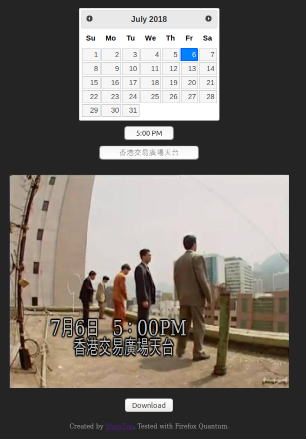

## ifc-roof: 香港交易廣場天台生成器

A modern meme generator for the HK drama 大時代 rooftop scene.

See [demo](https://shawtim.github.io/ifc-roof/) on Github page.



### Development

```bash
npm install
npm start
```

### Build (GitHub Pages)

```bash
npm run build
```

The static site is emitted to `docs/`.

### Preview Build Locally

```bash
npm run preview
```

### Core Features

1. Select date and time, input location, and render instantly
1. Full-width date/time style matching the scene overlay
1. Export generated image as PNG
